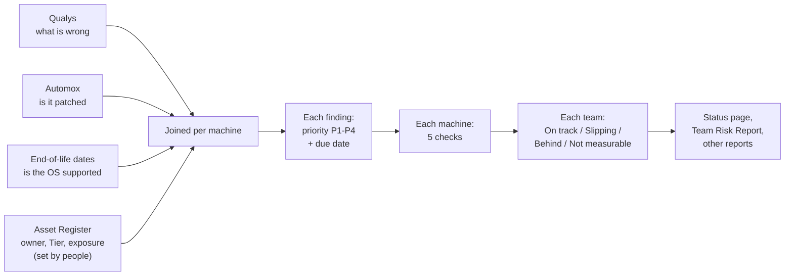
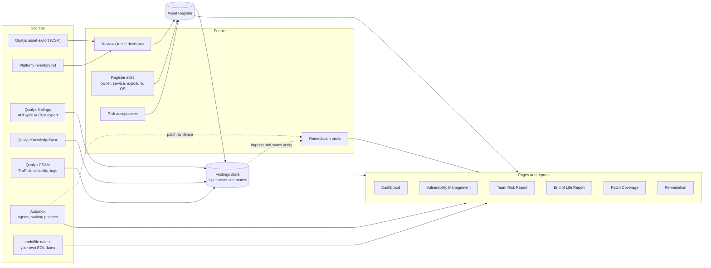

# CyberView

CyberView shows a security or infrastructure team where to focus. It joins your vulnerability findings (Qualys), patching (Automox) and end-of-life dates to an asset register that records who owns each machine and how important it is. From that it gives every finding a priority and a due date, every team a status, and two ranked lists: the machines to fix first and the fixes that clear the most.

- **One page of setup for your organisation:** teams, how machine names are matched, and the rules that suggest an owner for new machines (⚙ Organisation setup). Nothing about any one organisation is built into the code.
- **Runs on your own server:** three small containers (web app, MariaDB, HTTPS proxy), built from Debian packages, with users and roles. The Qualys and Automox connections are read-only.
- **Or with no server at all:** open `index.html` in a browser and the data stays in that browser. That is enough to try it with CSV exports.
- **Never colour alone:** every status has a word or a symbol, so it works for colour-blind readers and in print.

New here? Read **How it works, in plain words** below. The examples in this README use a team called *Platform*; your own team names come from the setup page.

## Quick start

```
git clone https://github.com/dylan7474/CyberView.git && cd CyberView
./deploy.sh --install-docker      # Debian only, once
./deploy.sh                       # build and start on HTTPS port 443
```

Then open the portal, create the administrator (👥 Users), fill in **⚙ Organisation setup**, and either connect the Qualys API (`./deploy.sh qualys ...`) or import a Qualys CSV export from *Vuln Management → Data & imports*.

## Overview

CyberView is an asset governance layer between discovery tools and operational reporting.

It treats discovery data as an input, and keeps its own Asset Register as the source of truth for ownership.

The goal is to stop repeated asset classification, simplify monthly reconciliation, improve ownership accuracy, and produce remediation plans people can act on.

---

## Running it as a server (MariaDB + containers, v3.0)

Besides the no-server mode (data kept in one browser), the portal can run as two containers on a Debian 13 host: the web app/API and a MariaDB database, so everyone shares one register and the data is backed up like any other database. Both images are built from Debian 13's own packages (`mariadb-server`, `python3-fastapi`).

```
git clone https://github.com/dylan7474/CyberView.git && cd CyberView
./deploy.sh --install-docker      # Debian only, once: installs docker.io + docker-compose from the Debian repo
./deploy.sh                       # build, start on HTTPS port 443 (port 80 redirects), wait until healthy
```

| Command | What it does |
|---|---|
| `./deploy.sh` | Rebuild and restart (a database backup is taken first if it is running). Safe to repeat for updates. |
| `./deploy.sh --listen ADDR --port N --http-port N --cert-names a,b` | Where it answers (v3.2). Default: **HTTPS on 443** of every address, plain HTTP on 80 only redirects to it. `--listen 127.0.0.1` restricts it to the machine. Saved in `.env`. An nginx container (Debian's package) does the TLS; the app itself is no longer published. |
| `./deploy.sh backup` | `mariadb-dump` to `backups/qualys-DATE.sql.gz` (newest 14 kept). Put it in cron for a nightly copy. |
| `./deploy.sh restore FILE` | Replace all data with a dump (takes a safety backup first). |
| `./deploy.sh users list \| add NAME [--role R] \| passwd NAME \| role NAME R \| disable \| enable \| unlock \| remove NAME` | Command-line user management (the Users page does the same). |
| `./deploy.sh clean` | Removes leftovers of older deployments: containers of this portal that belong to another folder or an older version (they would hold ports 80/443), and unused images. **Data is never touched.** Every `./deploy.sh` already does the container part first, and stops with a clear message if something else is using the ports. |
| `./deploy.sh clean --purge [--yes]` | Deletes this folder's portal completely, **including its database and users** (you must type `delete everything`). Databases of other copies are listed, not deleted. `.env` and `./certs` stay. Use it for a fresh start on a test server. |
| `./deploy.sh status` / `logs` / `stop` | Housekeeping. Data stays in Docker volumes when stopped. |
| `./deploy.sh automox key` | Store the Automox API key in `.env` (asked for, not shown) and restart the app (v3.12). `automox test` checks it from the server; `automox org ID` picks the organisation when the key sees several; `automox hours N` syncs on its own every N hours (0 = only by hand); `automox off` removes the key. See *Patch Coverage* below. |
| `./deploy.sh qualys url URL` | **Qualys API sync** (v3.13), read-only, replaces the capped CSV export. `qualys url https://qualysapi.YOUR-PLATFORM` (Qualys: *Help > About*), `qualys user`, `qualys pass` (asked for, not shown; stored encoded in `.env`, root only), `qualys tag "NAME"` to limit it to one Qualys tag (`qualys tag ""` = every host), `qualys hour H` for a daily sync at H:00 UTC (`qualys hour off` = only by hand), `qualys test` to check the login and reach from the server, `qualys watch` to follow a sync live, `qualys unblock` after a refused login, `qualys off` to remove the login. See *Qualys API sync* below. |

- **HTTPS certificate (v3.2):** on first start the proxy makes a **self-signed** certificate (10 years) into `./certs/` for the host name, `localhost`, and anything given with `--cert-names` (host names or IPs, comma separated). Browsers warn once per person until the certificate is trusted. To change the names, delete `./certs` and redeploy. To use a real certificate later (own CA, or Let's Encrypt via your own tooling), put `portal.crt` and `portal.key` in `./certs` and redeploy: nothing else changes. No HSTS is sent, so the browser warning can be clicked through. The sign-in cookie is Secure, and failed-login limits use the real client address.
- **Upgrading from v3.1 (port 80):** `./deploy.sh` rewrites `.env` itself; the portal moves to https://host/ and old http:// links redirect. Open port 443 in any host firewall.
- **Moving your existing data in:** open the old site, use *Export*, then open the container and use *Restore DB (JSON)*.
- **Where data lives:** register, review queue and the other small collections as one JSON row per record (`records`); vulnerability detections and the QID catalogue in their own indexed tables (`detections`, `qids`); a change log in `audit_log` (`/api/audit`). The database port is not published outside Docker.
- **Users and roles (v3.1):** until the first user exists the portal is in *setup mode*: open to everyone as administrator, with a red notice. `./deploy.sh` offers to create the first administrator; or open the site and use **Users**. After that everything needs a sign-in page.
  - **Viewer**: reads everything, changes nothing. **Editor**: imports, edits, reviews, records risk acceptances. **Administrator**: also manages users, restores a backup, resets the database, and sees the activity log.
  - Passwords: at least 10 characters, stored as PBKDF2-SHA256 hashes; an administrator can set a temporary one the user must change at first sign-in; five wrong passwords lock an account for 15 minutes; sessions end after 12 hours idle or 7 days, and at once when a user is disabled, deleted, re-roled or has their password reset.
  - **History** page: who changed which asset (field by field, old to new) and which risk acceptance, plus (administrators) an activity log of sign-ins, failed attempts, user changes, imports and restores. A very large import shows as one summary line.
  - Safeguards: you cannot change, disable or delete yourself, and the last active administrator cannot be removed. No single sign-on yet.
- **Assets the inventory does not know (v3.3):** an asset in a vulnerability export that is not in the register is no longer dropped. It joins the register flagged **⚑ Unrecognised** (owner "Unrecognised", shown in the Owner filters), keeps its findings, and gets one Review Queue item ("Seen in the vulnerability report, not in the inventory") with a suggested owner from the ownership rules. Approving it with an owner makes it a normal register asset; rejecting it removes it and its findings, and later imports leave it out. The dashboard banner counts what is still unassigned, so another team can find its own machines by owner.
- **Backup & Restore page (v3.3):** in the sidebar for everyone. Anyone can download a backup; restoring (JSON, with a preview and an automatic backup first) is for administrators, and the page says so if you are not one. The server-side `./deploy.sh backup` / `restore` for the database itself is explained there too. A new user made with `deploy.sh users add NAME` is an *editor* unless you add `--role admin`.
- **Two people at once:** each collection carries a revision. If someone else saved first, your save is refused and the page asks you to reload instead of overwriting their work. Changes by others show on reload (no live refresh yet).
- **Secrets:** `.env` holds the generated database password (not in git). The Qualys data never goes in this repo.
- **Tests:** `python3 tests/test_api.py http://127.0.0.1` against a *test* stack with no users (it clears the data and creates test users; remove them afterwards, see the top of the file).
- Opened from a file or a static web host (no server) the page keeps using browser storage exactly as before; the sidebar shows which mode it is in.

---

## Core Principles

### Asset Register is Authoritative

Ownership decisions are maintained within the Asset Register.

Discovery data can suggest classifications but must never overwrite existing decisions automatically.

### Discovery Sources are Advisory

Discovery platforms are used for:

- Asset discovery
- Vulnerability discovery
- Metadata enrichment

Discovery data is not treated as authoritative ownership information.

### Review Once

Assets should only require manual review when:

- Newly discovered
- Missing
- Materially changed
- Ownership conflicts are detected

Previously approved decisions should be preserved.

### Exception-Based Governance

The system focuses on:

- New Assets
- Missing Assets
- Changed Assets
- Ownership Conflicts
- Expired Risk Acceptances

Rather than requiring a full estate review each reporting cycle.

---

## How it works, in plain words

Start here. The exact rules are in the next section, *How the data fits together*.

### The short version

1. **The Asset Register is our list of machines.** For each machine it records who owns it (the team), what it is for (the service), how important it is (the **Tier**) and whether it faces the Internet (the **exposure**). People decide these. No import or sync ever changes them.
2. **Qualys tells us what is wrong with each machine.** Once a day the server downloads every finding from the Qualys API. The first editor who opens the portal after that applies the download. The *Vuln Management* badge shows this, and nobody needs to do anything else.
3. **Automox tells us whether a machine is being patched.** **endoflife.date** (plus our own dates) tells us whether its operating system still gets security fixes.
4. **Rules turn every finding into a priority and a due date.** The priority (P1 to P4) comes from how dangerous the finding is and how important the machine is. The due date is the date Qualys first found the problem plus 14 days for P1, 30 for P2, 90 for P3 and 180 for P4.
5. **Every machine gets a status, and every team gets one headline:** ✓ On track, ◐ Slipping, ✖ Behind or ? Not measurable. The headline mostly answers one question: *are we fixing our new P1 and P2 findings in time?*
6. **The reports show this same data in different ways.** Nothing is re-entered for a report.



### How a finding gets its priority

**Step 1: how dangerous is the finding?** Qualys's own data decides this:

| Finding tier | Meaning |
|---|---|
| **Fix now** | Known to be exploited (CISA KEV, active attacks, ransomware, wormable, zero day). |
| **This sprint** | Qualys Detection Score (QDS) of 70 or more, or remote code execution with a public exploit. |
| **Scheduled** | Severity 5, or QDS 40 or more. |
| **Routine** | Everything else. |

**Step 2: how important is the machine?** Its Tier comes from the register, where people set it by hand, like the owner. Tier 1 = Critical (it delivers a key service, or a critical service relies on it), Tier 2 = Supporting, Tier 3 = Other. You can give the tiers your own names and meanings on the Organisation setup page.

**Step 3: read the priority from the table.** An Internet-facing machine moves one step more urgent (P3 becomes P2, for example).

| | Tier 1 | Tier 2 (or not set) | Tier 3 |
|---|---|---|---|
| **Fix now** | P1 | P1 | P2 |
| **This sprint** | P2 | P2 | P3 |
| **Scheduled** | P3 | P3 | P4 |
| **Routine** | P4 | P4 | P4 |

*Example:* a severity 5 finding (Scheduled) on an internal Tier 3 server is **P4**, due 180 days after Qualys first found it. The same finding on an Internet-facing Tier 1 server is **P2** (P3 moved up one step), due in 30 days.

Administrators can change all these numbers on the **📐 Status Rules** page. Everyone can read them there.

### Two ready-made rule sets

The table and days above are the **Standard** rule set. The Status Rules page can switch to a second one with one button, and back again.

| | Standard | UK (NCSC + Cyber Essentials) |
|---|---|---|
| What the machine's Tier does | Changes the priority (the table above) | Decides what is worked on first; it never extends a deadline |
| Known exploited | P1 on Tier 1 and 2, P2 on Tier 3 | P1 on every machine |
| Severity 4 or 5 with a patch | Follows its Qualys score | At least P2 |
| Due, from first found | P1 14 days, P2 30, P3 90, P4 180 | P1 14 days, P2 14, P3 30, P4 90 |
| Internet-facing machines | One step more urgent | One step more urgent, and P1 and P2 due in 5 days |

**Where the UK figures come from:**
- **NCSC vulnerability management guidance:** prioritise Internet-facing services; update them within 5 days, operating systems and applications within 7, internal services within 14; go faster when a vulnerability is being exploited.
- **Cyber Essentials:** critical and high-risk fixes within 14 days of release, on every device in scope.
- **The P3 and P4 days** (30 and 90) are not set by either source; they are this portal's choice for lower-severity findings, and can be changed.

**Two limits to know about:**
- The clock starts when the scanner **first finds** the problem, not when the vendor released the patch (the Qualys API sync does not supply the patch release date). With a daily sync the two are usually a day or so apart, but a machine that is scanned late gets its 14 days from the scan.
- "Critical and high" is taken as **Qualys severity 4 or 5 with a patch available**. The API sync carries no CVSS scores, so the Cyber Essentials test of CVSS 7 or above cannot be applied exactly.

Switching rule set works out the priority and due date of every open finding again. Expect many more P1 and P2 findings under the UK set, because it treats every patchable severity 4 or 5 finding as urgent.

### New findings and the backlog

On the **go-live date** (the first day the rules were used), many findings were already old and overdue. Holding a team to 14 days for something found two years ago would make every team ✖ Behind from day one. The two kinds are therefore counted apart:

- **New findings** (first found on or after go-live) must meet the normal due dates. They decide whether a team is On track or Slipping.
- **Backlog** (first found before go-live) is the existing debt. It has its own deadlines: P1 cleared by go-live + 60 days, P2 by go-live + 90 days. If backlog P1/P2 are still open past those dates, the team is ✖ Behind. The team page has a burn-down chart of the backlog against its target.

### What the team headline means

| Headline | When |
|---|---|
| ✓ **On track** | At least 95% of new P1/P2 findings are within their due date, and no Tier 1 machine runs an unsupported OS. |
| ◐ **Slipping** | 80-95% within due date, **or** a team that would be On track whose figures got worse since about a day ago. |
| ✖ **Behind** | Under 80%, **or** a Tier 1 machine runs an unsupported OS, **or** backlog P1/P2 are past their target. |
| ? **Not measurable** | The figures cannot be trusted: under 80% of the team's machines were scanned recently, or more than 20% have no Tier. |

Each machine also gets five checks, and its overall state is the worst of them:
- **vulnerabilities** (✖ overdue P1/P2; ▲ P1/P2 with no task yet);
- **scan coverage** (✓ scanned in the last 14 days);
- **end of life**;
- **patching** (only for the teams patched by Automox);
- **exceptions** (✖ an accepted risk that has expired).

### What people have to do

The data cannot do these jobs itself. Until they are done, the reports are incomplete (a team shows ? Not measurable, or machines are counted at the wrong importance).

| Job | Why it matters | Where |
|---|---|---|
| **1. Approve new machines** | Gives each machine an owner and a service. New Qualys hosts arrive as *Unrecognised*, and Unassigned machines belong to no team. | Review Queue |
| **2. Set the Tier** of every machine | Without a Tier a machine counts as Tier 2. If more than 20% of a team's machines have no Tier, the team shows ? Not measurable. | Asset Register: filter *? Tier not set*, tick the machines, bulk edit *Tier* |
| **3. Set the exposure** (Internet facing or internal) | Internet-facing machines get priorities one step more urgent. Unknown exposure counts as internal. | Asset Register, Edit or bulk edit |
| **4. Mark appliances** *Cannot take an Automox agent* | Otherwise they show ✖ no agent on the patching check. | Edit, or bulk edit *Automox* |
| **5. Track the fixes** | A P1/P2 with no task shows ▲. A task records who fixes it and by when, and later syncs tick it off when Qualys no longer finds the problem. | ＋ Track on a fix row (Vuln Management), then the 🛠️ Remediation page |
| **6. Record accepted risks** | An exception takes those findings out of every count until its expiry date. After that date they count again. | ⚖ on a fix row, or *Accept risk* on a machine |

Jobs 2 and 3 are the big ones, but each is done once per machine. Jobs 1, 5 and 6 come up as new findings and machines appear.

### Turning it into a report

**Every day (automatic):** the Qualys sync runs. It is applied when an editor opens the portal. A snapshot of every team's figures is stored for the trend arrows and charts.

**Every week (each team):**
1. Open **🛡️ Vuln Management** and set *Showing: Team* to your team.
2. Machine owners work down list 1, **Machines to fix first**. Rollouts work down list 2, **Fixes that clear the most**.
3. Use **＋ Track** on list 2 to make tasks for the P1/P2 fixes that have none.
4. **🚦 Status** shows how the team is doing against the due dates.

**Every month (the management report):**
1. **Check the data is fresh.** On **🚦 Status**, *Data as of* lists every source with its date and flags any that are too old. Do not report on stale data.
2. **The one-page headline:** **🚦 Status** for the whole estate shows each team's headline, compliance, overdue and backlog figures, and ▲/▼ trend since yesterday. Press **🖨 Print** (save as PDF).
3. **One report per team:** open **📄 Team Risk Reports**, choose the team and *Actionable Only*, then press **🖨️ Print PDF**. It covers the summary, riskiest services and machines, the fix queue, governance gaps, actions for the next 30 days and remediation progress.
4. **Add as needed:** the **⏳ End of Life Report** (OS and hardware that need upgrading), **🩹 Patch Coverage** (Automox gaps) and **🛠️ Remediation** (tasks, overdue, closed on time). Each of these has *Export CSV*.

**Which page answers which question:**

| Question | Page |
|---|---|
| How is each team doing, and is it getting better? | 🚦 Status (estate view and team charts) |
| What exactly should team X fix first? | 🚦 Status team page, or 📄 Team Risk Report |
| Which machines should we fix first? | 🛡️ Vuln Management, list 1 *Machines to fix first* |
| Which fix clears the most machines? | 🛡️ Vuln Management, list 2 *Fixes that clear the most* |
| Who is fixing what, and is it late? | 🛠️ Remediation |
| Which machines run an OS that is out of support, or soon will be? | ⏳ End of Life Report |
| Which machines are not being patched? | 🩹 Patch Coverage |
| What did we accept, and when does it expire? | ✅ Risk Acceptances |
| What do the rules say? | 📐 Status Rules |

### When the numbers look wrong

- **? Not measurable:** set the Tiers (job 2), or check scan coverage. Machines Qualys has not scanned in 14 days cannot be judged.
- **Lots of Unassigned:** approve the Unrecognised machines in the Review Queue.
- **A finding came back:** an exception expired, or Qualys found the problem again after a task was verified (the task shows ⚠ REOPENED).
- **Figures did not change today:** the day's sync has not been applied yet. Opening the portal as an editor applies it. Its state is on Vuln Management (badge, sync panel and history).

---

## How the data fits together

The portal combines several sources. The **Asset Register** is the hub: every other source is matched to a register asset, and every report starts from the register, so ownership, service and scope always come from it. This section describes how it works as of **v3.18**. The gaps at the end were the input to the status design (`docs/vulnerability-status-design.md`); most are now closed.



### The sources

| Source | How it arrives | How often | Matched on | What it provides |
|---|---|---|---|---|
| **Qualys asset export** (Asset Datalist CSV) | Import Data | by hand | asset id, then name | New assets for the Review Queue. On re-import, existing assets get only their lifecycle stages, hardware name and Qualys criticality refreshed. |
| **Platform inventory** (list of names) | Import Data | by hand | name | Suggests the *Platform* owner for new assets. |
| **Qualys findings** | API sync (v3.13) or Asset Vuln Datalist CSV | daily sync, or by hand | asset id, then name | Every finding (QID, port, status incl. Fixed, first and last found, QDS). The sync is complete. CSV exports are capped at 50,000 rows and 500 per asset. |
| **Qualys KnowledgeBase** | with the sync (CSV: in the rows) | each sync | QID | Title, CVEs, threat flags (exploited, ransomware, etc.), patchable, solution. |
| **Qualys CSAM** | with the sync (CSV: in the rows) | each sync | asset id | TruRisk score, Asset Criticality Score (1-5), tags. |
| **Automox** | API sync (v3.12) | by hand or every N hours | hand link, then full name, short name, IP | Agent and check-in, waiting patches (with CVEs), policies, reboots. |
| **endoflife.date** | fetched by the page | cached a week | OS product and version | The date security fixes stop for each OS release. |
| **Your EOL dates** | End of Life Report | by hand | text match on the OS | Your own dates, e.g. extended support. |
| **Review Queue** | people | as new assets appear | - | Owner and service of each new asset, or reject it. |
| **Register edits** | people | any time | - | Owner, service, environment, status, exposure, criticality, OS correction. |
| **Exceptions** (risk acceptances) | people | any time | asset + QIDs, or whole asset | Accepted, with reason, control, proposer, approver, review and expiry dates. Per finding by default (v3.17). |
| **Remediation tasks** | people (Track buttons) | any time | asset + QIDs / OS / hardware | Who fixes what by when. Imports, syncs and Automox tick assets off. |

### Matching one machine across sources
- **Register assets** are keyed by a normalised name: lower case, with the company domain suffixes removed. They also carry the Qualys asset id.
- **Qualys findings and scores** match by asset id first, then by normalised name.
  - A Qualys host that matches nothing is added to the register flagged **Unrecognised**, with a Review Queue item and suggested owner and service. Hosts with no findings are not added.
  - Qualys often has two records for one machine: an IP-scanned one and a Cloud Agent one. Both map to the same register asset; an open finding beats a Fixed copy, and the higher TruRisk is kept.
- **Automox devices** match by a hand link first, then the full name, the short name and finally the IP. Ambiguous or duplicate matches wait under *To check*.
- **New assets** get a suggested owner: the main team's inventory list first, then the name rules, then the service type (all set on the Organisation setup page). People decide in the Review Queue. Qualys tags are **never** used for ownership, because they are often wrong.

### When sources disagree
| Field | Rule today |
|---|---|
| Owner, service, environment, exposure | Register only (Review Queue decision or edit). No import overwrites them. |
| Operating system | Your register edit wins. Qualys's OS is kept beside it, and a change in Qualys's OS flags the edit for checking. |
| OS end of life | Your EOL table, then endoflife.date. A Qualys stage of *EOL/EOS* always counts as unsupported. |
| Hardware stage | Qualys asset export. |
| Asset importance | **Tier** 1-3 (v3.15), set by people in the Review Queue, Edit or bulk edit; who and when are recorded; imports never change it. An unset tier counts as Tier 2 and is listed as a gap. Qualys's Asset Criticality Score is shown as a hint only, because it follows Qualys tags. The old register *Criticality* is retired (hand-set values are listed as suggestions on the Status Rules page). |
| TruRisk used in reports | The latest findings import or sync. The register keeps the value from when the asset was approved (see gaps). |
| Whether a finding is open | Its Qualys status: New, Active and Re-Opened are open. **Fixed is never counted as open** (v3.12.1); it only verifies remediation. |

### From findings to priorities
- **Action priority P1-P4** (v3.15) = the finding tier (below) × the asset's Tier, from the matrix on the **📐 Status Rules** page (Fix now: P1 on Tier 1 and 2, P2 on Tier 3; This sprint: P2/P2/P3; Scheduled: P3/P3/P4; Routine: P4). Internet-facing assets are one step more urgent. Unknown exposure counts as Internal.
- **Due date** = first found + the SLA for its priority (P1 14 days, P2 30, P3 90, P4 180). Findings first found **before the go-live date** (the day the rules were first used, or as set) are the **Backlog**: due at go-live + their backlog target (P1 60 days, P2 90, P3 90, P4 180), and reported apart. A task never moves a finding's due date.
- **Tier of a finding:**
  - **Fix now:** the QID is known exploited (CISA KEV, active attacks, ransomware, wormable, zero day).
  - **This sprint:** QDS 70 or more, or remote code execution with a public exploit.
  - **Scheduled:** severity 5 or QDS 40 or more.
  - **Routine:** everything else.
  - QDS comes from the API sync; a CSV gives QVS, which is almost always the same number.
- **Asset order:** see *Vulnerability Management: where to focus* for how machines and fixes are ranked.
- **Fixes** are grouped by QID (one row per fix, with how many assets need it). Related updates are folded into families.
- **Risk-accepted assets** are left out of the default views (*Open (Actionable)*). Choosing *All* shows them, counted apart.

### How each page is built
| Page or report | Uses |
|---|---|
| **Dashboard** | Register counts, Review Queue, per-asset finding summaries, coverage, remediation figures. |
| **Vulnerability Management** | Register filtered by team, exposure and risk status, joined to the **open** findings with their priorities: two ranked lists, machines and fixes (v3.19). Coverage and Qualys sync in *Data & imports*. |
| **Team Risk Report** | The same join for one team. Sections: summary, top risk services, highest risk assets, fix priority queue, governance health, actions for the next 30 days, remediation progress, AI plan. It does **not** include end of life or Automox data. |
| **End of Life Report** | Register OS, hardware and Qualys lifecycle stages, EOL dates, EOL software QIDs from findings, remediation tasks. |
| **Patch Coverage** | Register joined to Automox devices, and to open findings by CVE. |
| **Remediation** | Tasks, verified by findings imports or syncs (complete sync: absence on a scanned host = fixed) and by Automox (patch seen waiting, then installed). |

### Freshness and what "no findings" means
- Each source has its own date: the asset export when last imported, findings at the last sync or import, Automox at its last sync, endoflife.date within a week. The coverage panel names the findings sources and the sync panel shows the last sync. **The other pages and reports do not yet say how old their inputs are.**
- An asset with no findings is **clean only if Qualys scanned it**. Never-scanned hosts are left out of a sync (unknown, not clean). Hosts the sync does not cover keep what older CSV imports gave them, which may have been capped.

### Known gaps (input to the joined-up design)
1. ~~Two criticalities~~ **Done in v3.15:** one Tier, set by people (see above).
2. **Two TruRisk values (still open).** The register keeps the value from approval and an "effective risk", while the reports use the latest sync. Since v3.15, exposure does feed the priorities (Internet facing = one step more urgent); retiring the register's frozen copy is still to do.
3. ~~No single status per team~~ **Done in v3.16:** the 🚦 Status page (see *Status page*).
4. ~~No "data as of"~~ **Done in v3.16:** on the Status page and the Team Risk Report.
5. ~~Risk acceptance is per asset~~ **Done in v3.17:** per-finding exceptions with expiry (see *Exceptions*).
6. ~~Organisation values in code~~ **Done:** teams, domain suffixes, name and service rules and the export query examples are on the ⚙ Organisation setup page (see *Organisation setup*).

---

## Features

### Asset Reconciliation

Compare current asset discovery data against the Asset Register.

Identify:

- Existing Assets
- New Assets
- Missing Assets
- Changed Assets
- Ownership Conflicts

### Asset Register

Maintain:

- Ownership
- Service Classification
- Environment
- Criticality
- Lifecycle Status

Filter the register by keyword (name, IP, OS, tag, service), owner, service, environment, status, exposure, criticality and risk status. Tick assets (the header box selects everything the filters show), then use the blue bar to set owner, status, environment, service type, exposure or criticality on all of them at once. Only the fields you choose change, and you confirm before anything is applied.

### Review Queue

Provide a workflow for:

- Approving assets
- Rejecting assets
- Reassigning ownership
- Retiring assets

#### Correcting the operating system (v3.9)

Qualys sometimes detects the wrong OS. Change it like any other field: **Edit** on the asset, or **Operating system** in the register's bulk edit (type `-` there to go back to what Qualys reports; in Edit, empty the field).

- Imports never overwrite an edited OS. What Qualys reports is kept beside it (shown in Edit and on hover). If Qualys later reports a *different* OS, the asset shows **⚠ OS edited, Qualys changed** until someone checks it and saves the asset again.
- The edited OS is used everywhere: End of Life dates and status, remediation tasks, search, exports and AI prompts. The Qualys lifecycle stage is ignored for an edited asset (it belongs to the OS Qualys detected). Searching the OS field also finds the Qualys value.
- Edits show as **✎ OS edited** in the register and the End of Life list, and appear on the History page like other register changes.

#### Searching (v3.7)

The register keyword box and the End of Life asset list share one search:

- **Search in**: All fields, or one field (register: Name, IP, OS, Tags, Service, Owner; End of Life list: Name, OS, Owner, Service, Hardware). With *All fields*, a row matched outside its name shows `matched: tags` (etc.), because Qualys tags such as *My Team* and *Cloud Agent* match a lot.
- **Plain words** match anywhere ("contains"); several words must all match.
- **Wildcards** `*` (any characters) and `?` (one character): the pattern must match a whole value, so `web01*` = names starting web01, `*db0?` = names ending db0 plus one character. Lists (tags, IP addresses) are matched item by item, and OS names also without the Qualys build number.
- **Regular expression** between slashes, case-insensitive: `/^(lon|man)1.*web/`. A mistake shows "Invalid regular expression" under the box.

### Priorities, due dates and the backlog (v3.15)

Phase A of the joined-up status design (`docs/vulnerability-status-design.md`):
- **Tier** column, filter (including "? Tier not set"), Edit and bulk edit in the Asset Register. The Review Queue's bulk *Approve* asks for Tier and exposure (both optional).
- **📐 Status Rules** page: the data gaps (no tier, unknown exposure, old criticality values), the priority matrix, the Internet-facing step, SLA days, go-live date and backlog targets, the status check limits, the teams patched by Automox, and the staleness limits. Only administrators can change them; everyone can read them.
- Every open finding gets a priority, a due date and a backlog flag. Tasks made with *Track* take the most urgent priority of their findings and their earliest due date. Older tasks show their tier as P1-P4. The SLA settings are now named P1-P4.
- A Qualys API sync records each asset's last scan date (for the scan coverage check in phase B).

### Status page (v3.16)

Phase B of the status design. **🚦 Status** joins every source into one status per asset and per team; the Dashboard shows the same team headline.
- **Five checks per asset**, each with a state, a reason and its source:
  - **Vulnerabilities:** ✖ a P1/P2 past its due date; ▲ P1/P2 not covered by an open task; ◐ all tracked and in time; ✓ none.
  - **Scan coverage:** ✓ scanned within 14 days; ◐ 15-30 days; ? older, never, or not in the Qualys data. A CSV import has no scan date, so it shows "?" without overriding the asset.
  - **End of life:** ✖ unsupported; ▲ ends within 6 months; ◐ within 12; ? OS not recognised.
  - **Patching**, only for the teams set as patched by Automox: ✖ no agent; ▲ policy failing or reboot pending; ◐ patches waiting; ? stale agent or match to check. Other teams show *n/a*.
  - **Exceptions:** ✖ acceptance expired; ◐ review due.
- **Overall asset status** = the worst check. ? Unknown when the asset was not scanned recently, because its findings cannot be trusted.
- **Team status** (the headline):
  - ✓ **On track:** at least 95% of **new** P1/P2 findings within their due date, and no Tier 1 asset on an unsupported OS.
  - ◐ **Slipping:** 80-95%.
  - ✖ **Behind:** under 80%, or a Tier 1 asset on an unsupported OS, or **backlog P1/P2 still open past their target date** (v3.18.2).
  - ? **Not measurable:** scan coverage under 80%, or more than 20% of the team's assets have no tier.
  - Also shown: overdue P1/P2, the **backlog** P1/P2 with their target dates, unsupported OS, scan coverage, **agent coverage** (assets with a working Automox agent, for the teams patched by Automox), and the gaps (no tier, unknown exposure).
- **Unassigned:** assets whose owner is Unknown or Unrecognised form their own group, listed first.
- **Team page:** the assets that need doing now (✖ and ▲) first, with all five checks per asset. It can be printed.
- **Data as of:** every source with its date, flagged when older than its limit (Status Rules page). It is also shown in the Team Risk Report.
- **Priorities elsewhere:** Vulnerability Management ranks machines and fixes by priority (see *Where to focus*, v3.19). The Team Risk Report ranks assets by worst priority, then Tier, then TruRisk. An asset's findings show their priority and due date.
- The limits are all on the 📐 Status Rules page. Only administrators can change them; the server refuses changes from anyone else, except that an editor's page sets the go-live date once, when it is still empty.
- **Automox does not apply to some assets** (appliances, network devices). Tick *Cannot take an Automox agent* in Edit, or use the bulk *Automox* field: the patching check then shows n/a instead of ✖ no agent.
- **Scan dates** from the sync are kept in their own record (`gov_scan_dates`), so the daily apply does not rewrite the register under other people's edits.
- **Speed at all-hosts scale (v3.18.1):** the findings download is sent in large blocks and compressed by the web proxy (180,000 findings: 65 MB → 5 MB, and 52 s → 1.5 s on the server), so the Status page opens in a few seconds.
- **A page opened before a sync added new assets** (Unrecognised hosts) has an old copy of the register: editing it then shows *changed by someone else*, so reload first. Scan dates and everything else a daily sync changes no longer touch the register.
- **The Dashboard card** shows the latest snapshot (with its date), so landing on the Dashboard stays quick; the Status page works the status out live.

### Exceptions (v3.17)

Phase C of the status design: one mechanism for accepted risk.
- **Two scopes:**
  - **Specific findings** (the default): chosen QIDs on chosen assets. Only those findings are excepted; anything new on the assets still counts.
  - **Whole asset:** hides findings that appear later too, so it is marked ◐ and listed for conversion.
- **Ways to record one:**
  - the ⚖ button on a fix row in Vulnerability Management (the assets and QIDs come from the row),
  - *Accept risk* on an asset (type the QIDs, or choose whole asset),
  - setting a vulnerability task to *Risk accepted*, which opens the dialog with the task's assets and QIDs. Until it is recorded, the findings keep counting.
- **While in date** (status *Risk Accepted*, expiry not passed), the covered findings are left out of every count, priority and SLA figure, the way Fixed findings are. The asset's exceptions check says how many are excepted.
- **When the expiry date passes,** the findings count again automatically. A whole-asset acceptance then counts as Open again, and the asset's exceptions check shows ✖ *exception expired* until someone renews or revokes it. Past the review date: ◐.
- **The Risk Acceptances page** shows the scope of each record. Revoking a per-finding exception leaves the asset's own status alone.

### Status trend (v3.18)

Phase D of the status design.
- **Snapshots:** after each applied Qualys sync, a snapshot of every team's figures is stored (`gov_status_history`, the last 400, in backups): status, SLA compliance, overdue, backlog P1 and P2, asset states, coverage and gaps. Editors can also save one by hand from the Status page (useful with CSV imports).
- **Arrows on the estate table:** the change since about a day ago (the newest snapshot at least 20 hours old), as ▲ better / ▼ worse in words.
- **"Getting worse" means Slipping:** a team that would be On track is shown ◐ Slipping when its compliance fell or its overdue count rose since then.
- **Team page charts:**
  - **New P1/P2 within their due date (%)** over time.
  - **Backlog P1/P2 still open against the target:** the dashed line reaches zero for P1 by go-live + 60 days and for P2 by go-live + 90 days, starting from the backlog at go-live.
  - Hover a point for its value. A table view of the last 30 snapshots is underneath.

### Organisation setup

Everything specific to one organisation now lives on the **⚙ Organisation setup** page. It is stored in the database (`gov_org_settings`) and is part of every backup and restore. Only administrators can change it; the server refuses changes from anyone else. Everyone can read it.

- **Tier names and meanings.** The three tiers start as *Critical*, *Supporting* and *Other* (after the NCSC's guidance on critical assets and the systems they rely on). Rename them to suit your organisation. People set each machine's tier by hand in the Asset Register.
- **Teams** (the asset owners) and the **main team**. The main team owns the machines on the inventory list (Import Data), is counted on the Dashboard, is shown first on Patch Coverage, and is the default team patched by Automox. Every team list in the portal (filters, bulk edit, the Review Queue buttons, reports, tasks) is built from these. A team that is still used in the register always stays in the lists, so no asset loses its owner.
- **Domain suffixes**, removed from the end of machine names before Qualys, Automox and the register are matched. **Changing them changes how machines are matched**, so take a backup first; the page asks before saving a change.
- **Rules that suggest an owner and a service for new machines.** One rule per line, the first match wins: `starts`, `contains`, `ends` or `pattern` (a regular expression), the text, `=>`, then the result. For example `contains bkp => Platform`, or `tags contains monitoring => Monitoring` for a rule on the Qualys tags. A third list turns a service into an owner when no name rule matched (`Database => Platform`). **Try a name** shows how a name is matched and what it would get. People still decide in the Review Queue.
- **Words used in the portal:** the name under the portal title, the team the AI advises, and the Qualys export tip and example queries in *Data & imports*.
- **Export JSON / Import JSON** copy the setup between portals.

**A new portal** starts with example teams and a few generic service rules; the first administrator's visit saves them, and you change them on the page.

**A database or backup from before the setup page existed** has assets but no organisation setup. The portal then shows *Set up your organisation first* and pauses imports and Qualys syncs until an administrator saves the setup (or imports one, or restores a backup that includes it). Matching machine names with the wrong domain suffixes would create duplicate assets, so it waits instead of guessing.

### Vulnerability Management: where to focus (v3.19)

The page answers two questions: **which machines to fix first** and **which fixes clear the most**. It replaced the four boxes and four tabs of earlier versions. Those mixed tab links with filters, and showed "Fix now" three times.

- **Showing:** Team, Exposure and Risk status. **Urgency:** *All*, *P1*, *P1–P2* or *P1–P3*, the same P1–P4 as the Status page, the due dates and the tasks. The chosen urgency shows **●** and the others **○**, so no colour is needed. *More filters* holds Patchable and Severity.
- **One summary line** in plain text: what is shown, machines with findings, fixes, P1 findings, overdue P1/P2, and the share fixable by patching. Nothing in it is a button.
- **1. Machines to fix first** is ranked in this order:
  1. machines with overdue P1/P2 first;
  2. then the most P1, then the most P2;
  3. then Internet facing, then Tier 1;
  4. then the most P3;
  5. TruRisk only breaks ties.

  Each row says **why it is there** (e.g. *✖ 2 P1/P2 overdue · 3 P1 · 🌐 Internet facing*). Selecting rows and *Accept risk* work as before.
- **2. Fixes that clear the most** is ranked by urgency first, P1 before P2 and so on. Within each priority:
  1. overdue fixes first;
  2. then the most machines;
  3. then the most Internet-facing or Tier 1 machines among them (the **🌐 / T1** column);
  4. then QDS.

  Related updates are one row, as before (*Group similar fixes*). ＋ Track, ⚖ and the task markers are unchanged.
- **Why this order:** it follows the published guidance instead of a home-made score.
  - CISA's SSVC sorts vulnerabilities into action categories rather than adding numbers together.
  - The UK NCSC says to prioritise Internet-facing services, then the systems where an exploit would do the most harm, and points to SSVC.
  - Tenable's "top recommended actions" are sorted *by VPR category, then by decreasing assets affected*.
  - Our P1–P4 is the category (known exploited first, the machine's Tier, one step for Internet facing), so a P1 on one machine stays above a P2 on a hundred.
- Each list shows its top 10, with *Show all*, search and paging. A column header sorts by that column; **#** returns to the ranked order.
- **Data & imports** (a button at the top, collapsed) holds the Qualys sync, CSV import, the export query tips and the coverage panel. It opens by itself while a sync runs or when there is no data yet. The top line always says how fresh the findings are (*Data: Qualys sync 16 Nov 06:12 ✓*, or *⚠ 3 days old*).
- Team comparison is on 🚦 Status (linked under the lists), so the *Teams & services* tab has gone.

### Fix pages keep the filters (v3.18.3)

Clicking a fix opens its page (the vendor solution, the AI plan and the affected assets). The page now keeps the filters of the page you came from. Before v3.18.3 it always listed every team's assets.
- **From Vuln Management:** the team, exposure, risk status, urgency, severity and patchable filters.
- **From a Team Risk Report:** its team and risk status.
- **From Patch Coverage:** its team.
- A bar at the top says what is shown, e.g. **🔎 Showing: Platform only · risk status Open · 38 of 65 affected assets**. Its *Show all teams* link lists every asset, and *Back to …* returns to the filtered view.
- **＋ Track this fix** and the AI plan use the same assets the page shows.
- Opening an asset from the page and going back keeps the filter. A fix opened from an asset's own list inherits it too.
- Fixes opened from elsewhere, such as the Dashboard or the End of Life Report, still show every asset.

### Remediation tracking (v3.8, step 1)

A **task** is one fix on a set of assets: a Qualys QID or fix family, an OS upgrade, end-of-life software, a hardware model, one asset, or a manual task. It has an owner team, an assignee (a portal user), a priority, a due date, a status, a change/ticket reference and a comment log.

- **Create**: *＋ Track* on the *Fixes that clear the most* list (Vuln Management), *＋ Track this fix* in Inspect, and in the End of Life Report on the OS, software and hardware tables, on each asset row and for the whole filtered list. The dialog lists the assets (ticked), leaves out assets already in an open task for the same fix, and offers **one task per owner team** when the assets belong to several teams.
- **Due dates** come from the deadline rules on the Remediation page (Fix now 14 days, This sprint 30, Scheduled 90, Routine 180; end of life 30 days before the security-fix date, or 30 days when it has already passed; other 30). Changing the rules does not move existing tasks.
- **Statuses**: Open, Planned, In progress, Fixed (awaiting scan), Verified, Risk accepted, Cancelled. Each asset in a task is open, fixed, verified, excluded or moved.
- **Split**: tick assets in a task and *split into a new task*; they show as "moved to TASK-…" in the original.
- **Remediation page**: tiles (open, overdue, due in 14 days, awaiting scan, verified this month), filters (status, team, assignee incl. *Me* and *Unassigned*, type, overdue, due soon, search), bulk status/assignee/due, CSV export, deadline rules.
- **Server**: tasks are saved one at a time (`GET/POST /api/tasks`, `PUT /api/tasks/{id}` with the task's revision, `POST /api/tasks/{id}/comments`), so two people editing different tasks never clash; editing the same task at once gives "changed by … meanwhile" and shows their version. The server sets ids (TASK-0001…), who/when and the comment authors, checks the assignee is an enabled user (`GET /api/people`), and refuses whole-collection saves of the tasks. Task changes appear on the History page (asset changes as counts). Tasks and deadline rules are in backups and restores. Viewers can read tasks but not change them.
- **Local mode** (no server): tasks are kept in the browser; there are no assignees.

#### Checked by imports (v3.10, step 2)

Each asset in a task records what must change: the QIDs (vulnerability and end-of-life software tasks), the OS release, or the hardware model. Every import checks the open tasks (and verified ones, to catch a return):

- **Vulnerability export**: a tracked asset is **verified** when Qualys reports the QID *Fixed* for it, or when the QID is simply not there - but only if the file can prove it: the asset is in the file, the file is not cut off (Qualys's 50,000-row cap, or its notes say detections were left out), the asset has fewer than ~500 detections in it (Qualys's per-asset cap), and the QID appears somewhere in the file (a filtered export, e.g. CISA KEV only, leaves whole QIDs out). Otherwise the asset counts as "not provable" and stays as it was. The capped full exports therefore only verify through explicit *Fixed* rows; filtered exports below the cap (e.g. Platform assets only) verify by absence too.
- **Asset export**: an OS task's asset is verified when its OS release is no longer the one in the task (an OS edited in the register counts); a hardware task's when the model changed.
- A task whose assets are all verified **closes itself** (status Verified, with a comment). A verified asset whose finding comes back is reopened and its task shows **⚠ REOPENED**. An asset marked fixed by hand but still detected in a scan newer than the mark goes back to open with a note.
- Marking every asset of a task fixed sets the task to *Fixed, awaiting scan*.
- The import shows a one-line summary (verified, closed, came back, not provable).
- **Tracked markers**: fix rows in Vuln Management and the End of Life tables show the covering task (✓ TASK-0012, ⚠ when overdue, "30/65" when only part of the row's assets are tracked); ＋ creates a task for the rest. Asset detail lists the asset's tasks.

#### Figures (v3.11, step 3)

The **Dashboard** has a Remediation section and the **Team Risk Report** a section *7. Remediation Progress* for its scope (printed with the report):

- Tiles: open tasks (and assets still to fix), ⚠ overdue (share of open), due in 14 days, ⚠ reopened, verified this month (and fixed awaiting scan), **closed on time** (verified in the last 90 days by their due date) with the median days to close. On the Dashboard the tiles open the tracker with that filter.
- Tasks per month for the last 6 months: created (solid bars) and verified (striped bars), with the numbers and the open count at each month end in a table under the chart.
- Per team (Dashboard): open, overdue, assets to fix, verified in 90 days, on time. The five most overdue tasks.
- The report's recommended actions add: chase overdue tasks, look at reopened tasks, and Fix-now fixes that have no task yet.

### Risk Register

Support risk acceptance processes including:

- Acceptance Date
- Review Date
- Approved By
- Business Justification

### Reporting

Generate:

- Governance Reports
- Asset Ownership Reports
- Risk Reports
- Executive Summaries
- Action Plans
- End of Life Report (v3.4, dates v3.5): operating systems by the date security fixes stop (already unsupported, within 6 months, 6-12 months), hardware out of sale/support, and end-of-life software found by scans, per team

#### End of Life Report

Sources:

- **OS and hardware**: the Qualys lifecycle stages in the asset export (Asset Datalist CSV, columns `Operating System Lifecycle Stage` and `Hardware Lifecycle Stage`). Re-importing that export updates assets already in the register in place; nothing is queued for review again. Registers built before v3.4 show "No lifecycle data yet" until the export is re-imported.
- **Software**: every detection in the imported vulnerability exports whose Qualys title starts `EOL/Obsolete` (for example .NET 6, ESXi 7). This only covers assets that are in those exports, and filtered exports (for example only patchable or only CISA KEV) leave these QIDs out.

Qualys stages (CSAM): OS `GA` = supported; `EOL` = the publisher's first-level (mainstream) support has ended, so plan the upgrade; `EOL/EOS` = final support has ended and no more security fixes come, so upgrade, isolate or risk-accept now. Hardware `EOS` = end of sale (still supported); `OBS` = obsolete, no support. `Not Applicable` / `Unknown` = Qualys has no lifecycle for that release; the report counts these so a blank does not read as "supported".

**Dates (v3.5).** Each OS release gets the date its security fixes stop, from (1) the team's own table on the report (section 6, stored in the database as `gov_eol_dates`, included in backups, shared by everyone) and then (2) [endoflife.date](https://endoflife.date), fetched by the viewer's browser and kept a week (the ↻ Dates button fetches again). Covered: Windows Server, Windows 10/11 (by edition and feature update), RHEL, AlmaLinux, Rocky, Oracle Linux, CentOS, Debian, Ubuntu, SLES, ESXi, vCenter, Cisco IOS XE, FreeBSD. Anything else, or an OS name without a version, shows under "Releases with no date yet" with an *Add date* button.

Status, counted from today on the security-fix date: **Unsupported** (date passed, or Qualys says `EOL/EOS`), **Within 6 months**, **6-12 months**, **Over a year**, **No date**. The Qualys stage counts as well because endoflife.date lists RHEL by major version only: RHEL 9.2 is out of support (Qualys `EOL/EOS`) although RHEL 9 runs to 2032, and the fix is a `dnf update` to the latest minor. A date in your own table overrides both (for EUS or a paid extension).

**Acting on it (v3.6).** The asset list (section 5) has its own filters; the summary, OS table and hardware/software tables always show the whole scope.

- **Status**: Unsupported, Within 6 months, 6-12 months, Over a year, No date (tick any). EOL software and obsolete hardware count as Unsupported; hardware at end of sale counts as Over a year.
- **Reason**: Operating system, EOL software, Hardware. An asset is listed when one of its problems has a ticked reason AND a ticked status; it is placed by the most urgent of those.
- **Criticality** (all, 4-5, 5) and a **search** over asset, OS, owner, service and hardware.
- Clicking a summary tile sets the filters to exactly the assets behind its number.
- **Next action** per asset: *Upgrade OS now*, *Minor update to 9.x (dnf)*, *Plan OS upgrade before [date]*, *Remove or upgrade [software]*, *Replace hardware*, *Plan hardware refresh*, plus *Risk accepted until [date]* where a risk acceptance exists.
- **Export CSV** writes the filtered list (all rows, not only the 200 shown): asset, owner, service, criticality, TruRisk, status, OS, Qualys stage, security-fix date and source, hardware, EOL software count, next action, risk acceptance. Cells that start with `= + - @` are prefixed with `'` so Excel does not run them.

Assets are listed by the most urgent matching status, then Qualys criticality, then TruRisk.

### Patch Coverage from Automox (v3.12, server only)

The server reads Automox (**read-only**: GET requests only) and the sidebar page **🩹 Patch Coverage** shows it next to the register and the Qualys findings.

- **Setting up**: on the server, `./deploy.sh automox key` (paste the key; it goes into `.env`, readable by root only), then `./deploy.sh automox test`. The key never reaches the browser, backups, logs or the database; the page only learns *configured: yes/no*. Make the key for an Automox user with read access. If the key sees several organisations, choose one with `./deploy.sh automox org ID`. The server needs to reach `console.automox.com` on 443.
- **Syncing**: *⟳ Sync from Automox* (editors and admins) runs in the background: devices, then the patches waiting on them, then the installed patches of the devices that have open remediation tasks. Automox allows under 30 requests a minute, so the server spaces them out: about a minute for 275 devices and 11,000 waiting patches, plus about 3 requests per task device (at most 150 devices a sync). `./deploy.sh automox hours 24` adds a daily sync. Every sync is in the activity log.
- **Matching** an asset to a device: a hand link first, then the full name, the short name (before the first dot) and last the IP address (shown as *by IP only*: check those). **? To check** lists the rest: *Ambiguous* (several possible devices) and *Duplicate?* (the device fits another register asset better, often the same machine listed by name and by IP). Pick the device or say *No Automox agent*; links are shared and are in backups. Automox devices that are not in the register are listed with a box to link them.
- **Summary** (click a box to list those assets): ✓ Managed, ✗ No agent, ⏸ Stale agent (no check-in for 7 days), ⚠ Not compliant (a policy is failing; taken from the per-policy flags, because Automox's top-level `compliant` can say true while a patch policy fails), ↻ Reboot needed, ⧗ Patches waiting, ? To check.
- **Qualys findings Automox can fix**: each finding (by priority) with how many assets have an Automox patch waiting for it, how many are managed but have no such patch, and how many have no agent. The link is by CVE; Linux *Update for &lt;package&gt;* findings also match a waiting package of that name (marked ≈). Automox names CVEs mostly for Windows updates, so "no patch" can also mean Automox does not name it, and a Linux release past its end of life gets no updates at all.
- **Elsewhere**: an Automox panel in each asset's detail (check-in, OS, waiting patches with severity and known-exploited flags, policies, reboot, next patch window, and a box to correct the link), *🩹 Automox* on the asset's vulnerabilities that have a waiting patch, and an **Automox** filter in the Asset Register. CSV export of the asset list.
- **Remediation tasks**: Automox gives no install date (an installed package's date is when Automox catalogued that version, so a 2023 kernel shows 2023). The server therefore records a fix as *newly installed* only when it saw the patch **waiting in one sync and installed in a later one** (for devices of assets with open tasks). After a sync started from the page, or *Update tasks*, an asset in an open vulnerability task is marked **fixed (awaiting scan)** only when, for **every** QID of the task, such a newly installed patch names one of its CVEs, it was seen after Qualys last detected the QID (and after any reopen by an import), and no waiting patch names any of them. When all its assets are fixed, the task moves to *Fixed, awaiting scan* with a comment saying which packages. A waiting patch is noted on the asset. Nothing moves on the first sync. A scheduled sync refreshes the data but does not change tasks until someone opens the page and presses *Update tasks*. Qualys still decides: the next vulnerability import verifies the asset, or reopens it if Qualys still finds the problem.

### Historical Analysis

Track changes over time including:

- Asset Growth
- Asset Ownership Trends
- Risk Trends
- Vulnerability Trends
- Remediation Progress

### Backup and Restore

**Backup DB** downloads everything (register, review queue, risk acceptances, imported detections) as one JSON file. **Restore DB** reads such a file and replaces the portal's contents with it. It shows what the file contains first and offers to download a backup of the current data before replacing it. AI keys are never part of a backup.

### Qualys API sync (v3.13, server only)

The server reads the full data set from the Qualys APIs (**read-only**), with none of the export's limits (50,000 rows, 500 findings per asset). Set it up with the `./deploy.sh qualys ...` commands above; the login stays in the server's `.env` and never reaches the browser, backups or the database.

- **What a sync fetches**: the hosts in scope with their last scan date (VM Host List API), every finding including **Fixed** ones (Host List Detection API, 100 hosts a call), the KnowledgeBase entry of every QID found (title, CVEs, threat flags, solution; refreshed every sync so the exploited flags stay current), and each asset's **TruRisk** score, criticality and tags (CSAM asset search on the gateway, worked out from the API address). Measured on one estate: about 900 hosts, 95,000 findings and 8,600 QIDs took about 60 calls and 6–7 minutes, most of it the KnowledgeBase. Qualys allows 300 calls an hour; the sync stops itself at 280 and waits when Qualys says it is busy. Dropped connections (about 1 call in 20) are retried.
- **Applying it**: the sync is published only when the hosts, findings and KnowledgeBase all came in. If only the asset scores fail (the gateway is a different host, so a firewall may allow one and not the other), it is published with a warning and every asset keeps the TruRisk and criticality it had. The page then applies it exactly like a CSV import: matching to the register by asset id then name, new assets as *Unrecognised* in the Review Queue (with auto-categorisation), per-asset summaries, and the remediation check. After a *⟳ Sync from Qualys* (Vulnerability Management, editors) the page applies it when done; after a scheduled sync the **first editor who opens the portal** applies it (one page claims it, so it is applied once; it counts as applied only when every change reached the server, otherwise it is applied again later). Hosts in scope that were scanned get their findings replaced; hosts outside the tag keep what earlier imports gave them. A host that was never scanned is left out (unknown, not clean).
- **Remediation**: the sync is *complete*, so a finding that is no longer reported on a scanned host counts as gone, with no row caps to allow for; an explicit Fixed finding counts as before. Two Qualys records for one machine (IP scan and Cloud Agent) are folded into its register asset, and an open finding beats a Fixed copy.
- **Fields**: QDS (per finding) takes the place of the export's QVS for the priority tiers; the threat flags are mapped to the export's wording. The KnowledgeBase reply carries **no CVSS** scores, so CVE lists from the API show none.
- **The login**: if Qualys refuses it, syncs stop at once (no retries), so a wrong password cannot lock the account; set it again with `./deploy.sh qualys pass` or, if it was right, `./deploy.sh qualys unblock`. A changed Qualys password needs `qualys pass` too. The status line on the Vulnerability Management page shows the last sync, failures and who applied it. Every sync and apply is in the activity log.
- **Watching a sync (v3.14)**: the Vulnerability Management page shows each step as it runs (✓ done, ⟳ running, · waiting, ✗ failed) with counts, a progress bar for the KnowledgeBase, time taken so far and an estimate from the last sync, the API calls used and how many more Qualys allows this hour, plus a short log of anything unusual (retried connections, waits when Qualys is busy, warnings). The apply in the browser has its own steps (download, match, save, checks). Afterwards: how long each step took and what changed since the previous sync (new open findings, findings no longer open, hosts added or gone). **Sync history** keeps the last 30 syncs, failed ones included, with who started and applied each. The sidebar shows a badge on *Vuln Management* when a sync is running, failed, is waiting to be applied, or the login was refused. On the server, `./deploy.sh qualys watch` prints the same progress in the terminal (it follows the running sync, or waits for the next one; Ctrl+C stops watching, not the sync); sync events also go to `./deploy.sh logs`. A sync cut off by a restart is marked *interrupted*.
- **Not from the API yet**: End of Life stages (the asset search returned none), so the End of Life report still uses the asset CSV export.

### Importing Vulnerability Exports

Qualys cuts an Asset Vuln Datalist export off at **50,000 rows**, and often does not say so. Filter the export in Qualys so it stays under the cap, then import it from Vulnerability Management. Imports merge per asset, so several filtered exports combine; leave "replace all" off after the first.

Example queries (put your own Qualys tag in; your own examples can be saved on the Organisation setup page):

```text
asset.tag.name:`Your Tag` AND finding.vulnerability.threatIntel.isCisaKnownExploitedVuln:TRUE
```

```text
(finding.vulnerability.threatIntel.isCisaKnownExploitedVuln:TRUE) and (finding.qds:[90 ... 100] and finding.isQualysPatchable:TRUE)
```

Qualys **Fixed** rows are used only to verify remediation tasks; they are not counted as open findings anywhere (v3.12.1; earlier versions counted them, and stored summaries are recounted once on the first editor's page load).

The portal warns when a file looks truncated: when Qualys reports missing detections, or when the file reaches about 49,000 rows. If the portal warns, narrow the filter or split the export (by severity or asset tag) and import the parts.

---

## Asset Lifecycle

```text
Discovery
    ↓
Review Queue
    ↓
Approved / Rejected
    ↓
Asset Register
    ↓
Reporting & Governance
```

## Licence

MIT. Copyright (c) 2026 Dylan Jones. See [LICENSE](LICENSE).

CyberView is not affiliated with Qualys, Automox or endoflife.date. Their names are used only to say which data it reads.
