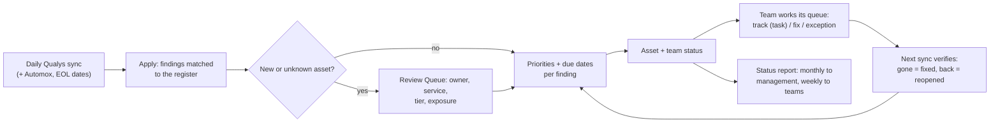

# Joined-up vulnerability status: design (agreed)

Status: **agreed 13 Nov 2026** (all eight decisions as proposed; backlog option **C**, targets P1 60 days, P2 90 days). **Built:** A v3.15.0, B v3.16.0, C v3.17.0, D v3.18.0 (13 Nov 2026). The README describes the result; this file keeps the reasoning.

**Not done or changed while building (13 Nov 2026):**
- The register's frozen TruRisk copy and its "effective risk" are not retired yet (README gap 2).
- The single *Approve* button in the Review Queue does not ask for Tier and exposure; the bulk Approve does.
- **Decided 13 Nov 2026 (user):** a backlog P1/P2 past its target date is ✖ overdue on the asset, and makes the **team ✖ Behind** (v3.18.2).
- Added: a per-asset "cannot take an Automox agent" option, because appliances cannot have one; scan dates kept in their own collection; the Dashboard card reads the latest snapshot. It follows on from *How the data fits together* in the README, whose "known gaps" it closes. The figures marked **dry run** come from the real Platform data of 13 Nov 2026: 881 hosts and 66,180 open findings on 723 assets, from the Qualys API.

## 1. What it is for

Every team should get **one status**, drawn from every source and explained, that says:
- how exposed it is,
- what to do next, in what order,
- by when, and
- **whether it is keeping up.**

The same rules must give the same numbers on every page.

**Principles**
1. **The register decides scope and ownership.** Qualys tags are never used for either, and not for importance either (see 3).
2. **One rule per question** (how important, how urgent, is it OK), written down here and in the README.
3. **Unknown is not clean.** No scan, a stale scan, an unset tier or unknown exposure is shown as a gap, never quietly treated as fine.
4. **Every number shows its source and age.**
5. **People can override, visibly** (who, when), and overrides expire or are re-checked.
6. **The status drives work.** Anything not OK leads to a task, an exception or a data fix.
7. **The rules are settings**, with today's values as the defaults. This is a step towards having nothing organisation-specific in the code.
8. **The status must tell teams apart.** A rule that marks almost everything red is not used.

## 2. The flow: who does what, when

| When | Who | What |
|---|---|---|
| Daily, 06:00 UTC | server | Qualys sync, applied by the first editor's page; the Automox sync; a status snapshot stored |
| Daily | asset admin | Review Queue: owner, service, **tier**, **exposure** for new or Unrecognised assets |
| Weekly | each team | their status page: overdue and P1 first; track (task with an assignee) or fix; propose an exception when a fix is not possible |
| Weekly | approver | review proposed exceptions, and expired or expiring ones |
| Monthly | management | the estate status report: trend, SLA compliance per team, top risks, exceptions |

## 3. Asset importance: one **Tier**, set by people

This replaces the register *Criticality* (High/Medium/Low, shown but never used for ranking) and the hidden use of the Qualys Asset Criticality Score (ACS).

| Tier | Meaning |
|---|---|
| **Tier 1**: crown jewels | customer- or business-critical; a compromise is a major incident |
| **Tier 2**: important | production systems that matter |
| **Tier 3**: least critical | test, lab, internal tooling |

- **Set by people** in the Review Queue, Edit or bulk edit, with who and when recorded. Imports never change it.
- **Not defaulted from Qualys.** **Dry run:** the ACS follows the "N - …" criticality **tags** (tag 4 gives score 4 on 701 assets, tag 5 gives 5 on 323, untagged gives the default 2 on 471), so it is a tag in disguise.
- **An unset tier counts as Tier 2** for priorities, so it is not the most lenient. It is listed as a data gap ("tier not set") and the Qualys ACS is shown beside it as a **hint**.
- **The old register Criticality** is shown on a one-off review list where someone set it by hand (to confirm: on the real register it may nearly all be the default *Medium*). It is then retired.

## 4. Finding urgency, then **action priority** and **due date**

**Finding tier** is unchanged:
- **Fix now:** known exploited.
- **This sprint:** QDS 70 or more, or RCE with a public exploit.
- **Scheduled:** severity 5 or QDS 40 or more.
- **Routine:** everything else.

**Dry run:** 2,315 Fix now, 4,027 This sprint, 12,462 Scheduled, 47,376 Routine.

**Action priority** = finding tier × asset tier. **Internet facing** moves it one step up. **Unknown exposure** counts as Internal and is listed as a gap. Today every approved asset gets exposure *Unknown*, so the step does nothing until exposure is filled in; the Review Queue will ask for it.

| Finding tier \ Asset tier | Tier 1 | Tier 2 (or unset) | Tier 3 |
|---|---|---|---|
| **Fix now** | **P1** | **P1** | P2 |
| **This sprint** | P2 | P2 | P3 |
| **Scheduled** | P3 | P3 | P4 |
| **Routine** | P4 | P4 | P4 |

- **Due date** = when the finding was first found + the SLA for its priority. Defaults: **P1 14 days, P2 30, P3 90, P4 180.**
- **Overdue** = open past its due date, with no exception in date.
- **Tasks do not move due dates.** A task means the finding is *tracked* (someone owns it). An overdue finding stays overdue even with a task, so a far-off task date cannot hide it.
- **A task's own priority** = the highest priority among its assets' findings. Its default due date = the earliest finding due date. The existing task priorities t1-t4 become P1-P4 with the same SLA days.

**Dry run** (every asset Tier 2, because nobody has set tiers yet):
- 2,315 P1, 4,027 P2, 12,462 P3, 47,376 P4.
- **13,448 overdue (20% of open findings):** 2,158 P1, 3,240 P2, 8,050 P3.
- Median age of an open finding: 107 days.

### The backlog: decision needed

Counting from first found, today's backlog is overdue on day one. Three options:

| Option | Rule | Day-one effect (dry run) | Trade-off |
|---|---|---|---|
| **A. Strict** | SLA from first found, always | 13,448 overdue; ~600 assets with an overdue P1/P2 | honest, but swamps the report from the start |
| **B. Go-live clock** | findings first found before go-live get their SLA counted from go-live | nothing overdue on day one, then a cliff 14 days later | clean start; the cliff must be planned for |
| **C. Backlog track** (recommended) | findings first found before go-live are a separate **Backlog**, reported apart, with a burn-down target (e.g. P1 backlog cleared in 60 days, P2 in 90); new findings follow the strict SLA | new work is measured honestly from day one; the backlog has its own visible target | one more number to explain |

## 5. Status: measure keeping up, not "has any finding"

**Dry run:** a "worst finding" rule makes **599 of 723 Platform assets Critical** (strict) or **609 "At risk"** (go-live clock). Almost every asset has at least one known-exploited finding (OS patches with CISA KEV CVEs). Such a status does not tell teams apart (principle 8). So:

### 5.1 Asset status (for drill-down and work queues)
Five checks. Each check gives a state, a reason, the source and its age.

| Check | ✓ OK | ◐ Watch | ▲ Action | ✖ Overdue | ? Unknown |
|---|---|---|---|---|---|
| **Vulnerabilities** | no open P1/P2 | P1/P2 open, all tracked and in SLA | P1/P2 open and **not tracked** | any P1/P2 **past due** (new findings only under option C) | - |
| **Scan coverage** | scanned within 14 days | 15-30 days | - | - | older than 30 days or never (**dry run: 64 of 881**) |
| **End of life** | supported for more than 12 months | ends within 12 months | ends within 6 months | **unsupported now** | OS not recognised |
| **Patching** (teams that use Automox) | agent OK and compliant | patches waiting | policy failing / reboot pending over 7 days | **no agent** | agent stale for 7 or more days |
| **Exceptions** | none, or in date | review due | - | **expired** | - |

- **Overall** = the worst check. *Unknown* coverage is shown first, because the vulnerability check cannot be trusted without a recent scan.
- **Symbols and words, never colour alone:** ✓ ◐ ▲ ✖ ?
- **Patching applies only to the teams set as "patched by Automox"** (default: the main team). For other teams, and in local mode or with no Automox, the check shows *not applicable*. **Dry run:** Automox has 275 devices against 1,755 assets in an all-hosts sync, so a per-asset "no agent" rule would wrongly flag about 1,500 other-team machines.
- **Scan date:** the sync's last scan date is stored on each asset when the sync is applied. CSV imports have none: those assets show "? no scan date" under coverage, which counts as a gap but does not override the vulnerability check.

### 5.2 Team status (the headline): **SLA compliance and trend**
The headline per team is the % of open P1/P2 findings that are within SLA (new findings only under option C), with:
- its trend since the last report,
- the number of overdue findings,
- the backlog remaining against its target (option C),
- end-of-life assets, scan coverage and patch coverage as %,
- data gaps: tier not set, exposure unknown, no scan date.

A team's word is set by thresholds that are settings:

| Team status | Default rule |
|---|---|
| ✓ **On track** | P1/P2 SLA compliance ≥ 95%, no unsupported OS on Tier 1, coverage ≥ 95% |
| ◐ **Slipping** | compliance 80-95%, or the trend worse than last time |
| ✖ **Behind** | compliance < 80%, or an unsupported OS on Tier 1 |
| ? **Not measurable** | coverage < 80%, or more than 20% of assets without a tier |

### 5.3 Assets without a team
Assets whose owner is Unknown or Unrecognised (91 after the all-hosts sync) are reported as their own group, **"Unassigned"**. Its status is "? Not measurable" until the assets are reviewed. Unassigned is the first item in the estate report, because nobody fixes what nobody owns.

## 6. One exception mechanism

Today there are three ways to accept risk: the asset `riskStatus`, the task status "Risk accepted", and (proposed) per finding. They become **one**:

- **An exception** = scope (one QID on chosen assets, a whole team for one QID, or a whole asset) + reason, compensating control, proposer, approver, review date and **expiry**.
- **While it is in date,** the covered findings are *excepted*: not overdue, not counted in SLA compliance, and shown apart.
- **At expiry they count again automatically,** and the Exceptions check flags them.
- **A task set to "Risk accepted"** creates an exception for its assets and QIDs (approval needed).
- **The existing per-asset acceptances** become whole-asset exceptions, flagged for conversion: they hide *new* findings too.
- **New exceptions default to per finding.**

## 7. Engine, settings, storage

- **`StatusEngine`** (one class, used by every page) computes per asset: tier (with source), priorities, due dates, backlog membership, the five checks and the overall status. Per team it computes compliance, trend and gaps. It works from data the page already loads, so there are no new API calls.
- **Settings** (admin; included in backups):
  - the priority matrix and the Internet-facing step,
  - SLA days,
  - the backlog option, go-live date and burn-down targets,
  - the check thresholds and the team status thresholds,
  - the teams patched by Automox,
  - the staleness limits.
  These are the first parts of a setup screen.
- **Storage:**
  - register fields `tier`, `tierBy`, `tierAt`, `lastScan` (from the sync);
  - collections `gov_status_settings` and `gov_status_history` (one snapshot per applied sync: per-team counts, compliance, backlog);
  - exceptions in the existing risk-acceptance collection, with `scope` and `qids`.
- **TruRisk:** one value, from the latest import or sync. The register's frozen copy and its "effective risk" are retired; exposure now works through the priorities.
- **Asset order everywhere:** worst priority, then Tier, then TruRisk, then the number of P1s.

## 8. Order of work

| Phase | Delivers |
|---|---|
| **A: foundations** | Tier (+ Review Queue, edit, bulk, ACS hint, gaps list); exposure asked in the Review Queue; priorities, due dates, backlog option; StatusEngine core; settings page; `lastScan` stored at apply; task priorities migrated |
| **B: status** | Five checks + asset status; team status + **Status page/report** with "Data as of"; Unassigned group; Dashboard headline; priorities and due dates in Vulnerability Management and the Team Risk Report; Automox per team |
| **C: exceptions** | The single exception mechanism with expiry; conversion of existing acceptances |
| **D: trend** | Snapshots per sync, trend charts, burn-down; README rules finalised |

Each phase is its own version, tested on real data on a throwaway stack, with the README updated in the same commit.

## 9. Decisions needed

1. **Tier:** set by people only, an unset tier counts as Tier 2 and is listed as a gap, and the Qualys ACS is a hint only (section 3)?
2. **The priority matrix and the Internet-facing step** (section 4)?
3. **SLA days:** P1 14 / P2 30 / P3 90 / P4 180, from first found?
4. **The backlog:** A strict, B go-live clock, or **C backlog track** (recommended), and the burn-down targets?
5. **The team headline:** SLA compliance and trend with the thresholds in 5.2, and the asset checks in 5.1?
6. **One exception mechanism**, per finding by default, with expiry that reopens (section 6)?
7. **Teams patched by Automox** for the patching check (default: the main team only)?
8. **The flow and cadence** in section 2: daily review, weekly team queue, monthly management report?
